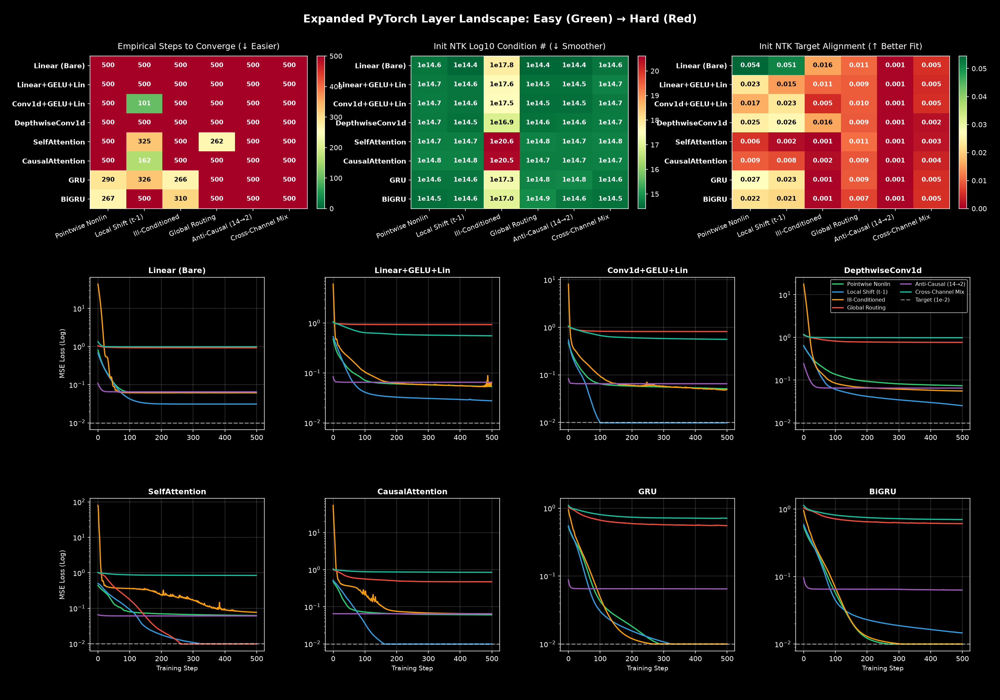

# PyTorch Layer Difficulty Landscape & Inductive Bias Benchmark

An empirical and analytical benchmarking suite designed to map the **Easy → Hard** input landscape across core PyTorch neural network primitives. 

By pairing **initial Neural Tangent Kernel (NTK) diagnostics** (snapshot at step 0) with **empirical training convergence curves** (`AdamW` over 500 steps), this project visualizes how different architectural inductive biases succeed or hit structural walls on distinct data regimes—and how deterministic **mechanical input transformations** ($T(x)$) can reshape "hard" inputs into "easy" ones.

---

## 1. Methodology & Diagnostic Metrics

Every layer primitive is standardized to accept a 3D sequence tensor of shape `(Batch, Seq_Len=16, Channels=16)` and evaluated across three metrics:

1. **Empirical Steps to Converge ($\downarrow$ Easier):** Number of `AdamW` optimization steps required to reach `MSE < 1e-2` (capped at `500`).
2. **Initial NTK Condition Number ($\downarrow$ Smoother):** Computed via `torch.func.jacrev` on the parameter Jacobian $J$ at initialization ($K = J J^T$). High condition numbers ($\ge 10^{17}$) warn of severely warped loss landscapes and gradient instability before training begins.
3. **Initial NTK Target Alignment ($\uparrow$ Better Fit):** Measures cosine alignment between the layer's initial Jacobian kernel $K$ and the target output $y$, quantifying how naturally the layer's inductive bias matches the problem structure.

---

## 2. Layer Landscape Results: Good vs. Bad Regimes


The table below summarizes findings from the **8 Layer Primitives × 6 Problem Regimes** benchmark (`d=16`, `L=16`):

| Layer / Combination | Architectural Bias | Strongest / Easy Regimes (Good At) | Structural Blind Spots / Hard Regimes (Bad At) | Key Takeaway |
| :--- | :--- | :--- | :--- | :--- |
| **`Linear (Bare)`** | Pointwise affine transformation ($xW^T + b$) | **Pointwise Linear Tasks** (Fastest initial NTK alignment on simple projections) | **Nonlinear Functions** (`sin(x)`), **Temporal Shifts** ($t-1$), **Global Routing** | Hits an algebraic ceiling on any nonlinear curve; completely blind to neighboring time steps. |
| **`Linear + GELU + Lin`** | Pointwise universal function approximator (MLP) | **Pointwise Nonlinearities** (`sin(x)`), **Cross-Channel Mixing** (with sufficient width) | **Temporal Shifts** ($t-1$), **Global / Anti-Causal Routing** | Operates strictly per token ($t$); structurally incapable of moving information across sequence positions without a pre-transform. |
| **`Conv1d + GELU + Lin`** | Local sliding window (`kernel_size=3`) + channel mixing | **Local Temporal Shifts ($t-1$)** (Fastest convergence in benchmark: **101 steps**) | **Global Content Routing**, **Long-Range Anti-Causal Routing** | Ideal for local spatiotemporal patterns; requires a trailing `1x1` projection so `GELU` doesn't clip negative outputs at `-0.17`. |
| **`DepthwiseConv1d`** | Per-channel temporal filtering (`groups=d`) | **Independent Per-Channel Time Filtering** | **Cross-Channel Interactions** ($x_c \cdot x_{c+1}$), **Global Routing** | Isolating channels saves parameters, but creates a hard structural wall whenever features must interact across channels. |
| **`SelfAttention`** | Bidirectional all-to-all content routing | **Global Content Routing** (**262 steps**), **Anti-Causal Routing** ($t=14 \to t=2$) | **Pure Pointwise Nonlinearities** (averages tokens instead of transforming features individually) | Connects any token to any other token in 1 hop, but struggles without a paired FFN (`Linear+GELU`) for token-wise math. |
| **`CausalAttention`** | Unidirectional (past-to-future) content routing | **Causal Global Routing** (Fastest attention convergence on forward routing: **163 steps**) | **Anti-Causal Routing** ($t=14 \to t=2$), **Pointwise Nonlinearities** | Masking prevents future leakage (ideal for autoregressive LLMs), making backward-in-time routing structurally impossible. |
| **`GRU`** | Left-to-right sequential recurrent state + gating | **Pointwise Nonlinearities** (**290 steps**), **Local Shifts** (**326 steps**), **Ill-Conditioned** (**266 steps**) | **Anti-Causal Routing** ($t=14 \to t=2$), **All-to-All Global Broadcast** | Built-in sigmoid/tanh gates make it remarkably resilient to extreme `50x` feature scale warps (`Ill-Conditioned`), but strictly left-to-right. |
| **`BiGRU`** | Bidirectional sequential recurrent state | **Pointwise Nonlinearities** (**267 steps**), **Ill-Conditioned** (**310 steps**), **Anti-Causal Routing** (steeply converging) | **High-Speed Parallel Global Broadcast** (sequential state bottleneck) | Fixes `GRU`'s backward blind spot by running forward and backward passes, while retaining gated stability on poorly scaled inputs. |

---

## 3. Core Insights & Mechanical Input Transformations

1. **Structural Walls vs. Optimization Bottlenecks:**
   * **Flat horizontal loss curves** indicate a *mathematical impossibility* for that layer's receptive field (e.g., `Linear` on `Local Shift`, or `CausalAttention` on `Anti-Causal Routing`). No amount of extra training steps will fix them without changing the input representation.
   * **Sloping loss curves** (e.g., `BiGRU` on `Anti-Causal`) indicate *capacity or step-count limits* that resolve with wider hidden dimensions or longer training.
2. **Pre-Training Diagnostics Work:**
   * Across every layer family, the `Ill-Conditioned` regime (`50x` scale spike on Feature 0) spiked the step-0 NTK condition number to $10^{17}–10^{20}$, accurately predicting training stalls before a single gradient step occurred.
3. **How Mechanical Transformations ($T(x)$) Rescue Red Regimes:**
   * **Scale Warps (`Ill-Conditioned`) $\to$ `LayerNorm` / `RMSNorm`:** Restores isotropic feature scaling before the layer sees the data.
   * **Temporal Blindness (`Linear` on `Local Shift`) $\to$ Neighbor Concatenation (`[x, roll(x, 1)]`):** Exposes adjacent time steps as features so a pointwise layer can solve temporal shifts in one step.
   * **Spectral Bias (High-Frequency Waves) $\to$ Fourier Feature Mapping (`[sin(wx), cos(wx)]`):** Converts rapid oscillations into linear feature selection.
   * **Safety Rule:** Concatenating `[x, T(x)]` rather than overwriting `x` ensures the layer gains the easier representation without losing raw input information.

---

## 4. Running the Benchmark

```bash
pip install torch numpy matplotlib
python layer_difficulty_landscape.py
```

Generates `layer_difficulty_landscape_8x6.png` containing:
* **Top Row:** Heatmaps of Empirical Convergence Steps, Initial NTK $\log_{10}$ Condition Number, and Initial NTK Target Alignment.
* **Bottom Rows:** Log-scale MSE training trajectories across all 8 layer primitives.


## Layer Primitives: Strengths, Blind Spots & Mechanical Reasoning

| Layer / Combination | Basic Description | Good At Solving | Bad At Solving | Why It Is Good / Bad |
| :--- | :--- | :--- | :--- | :--- |
| **`Linear (Bare)`** | A single matrix multiplication plus bias ($y = xW^T + b$) applied independently to each time step. | • Simple linear projections<br>• Scaling and rotating features at a single point in time | • Any curved/nonlinear function (`sin(x)`)<br>• Temporal shifts ($t-1$)<br>• Routing info across positions | **Good:** Straightforward linear geometry gives clean gradients on simple mappings.<br>**Bad:** Without a nonlinearity, stacking or training linear weights can *only* produce flat lines/planes; it also has zero visibility into neighboring time steps. |
| **`Linear + GELU + Lin`** | Two linear layers sandwiching a smooth `GELU` activation (a standard MLP block), applied token-by-token. | • Pointwise nonlinear functions (`sin(x)`)<br>• Combining features within the same token (with enough width) | • Local temporal shifts ($t-1$)<br>• Global or backward token routing | **Good:** `GELU` bends straight lines into smooth curves, making it a universal function approximator for single-token math.<br>**Bad:** It processes each time step in total isolation—it has no mechanism to look left or right across the sequence. |
| **`Conv1d + GELU + Lin`** | A sliding window (`kernel_size=3`) that mixes neighboring time steps and all channels, followed by `GELU` and a `1x1` linear projection. | • **Local temporal shifts ($t-1$)** (fastest in benchmark: **101 steps**)<br>• Local wave/pattern detection | • Global content routing<br>• Long-range backward routing ($t=14 \to t=2$) | **Good:** The `kernel_size=3` window physically overlaps adjacent time steps ($t-1, t, t+1$), matching local shifts naturally.<br>**Bad:** Information only travels 1 step left or right per layer, so moving a signal 12+ steps away in a single layer is structurally impossible. |
| **`DepthwiseConv1d`** | A sliding window (`groups=d`) where every channel has its own separate filter and cannot see other channels. | • Independent per-channel time filtering<br>• Per-channel smoothing or shifting | • **Cross-channel interactions** ($x_c \cdot x_{c+1}$)<br>• Global routing | **Good:** Parameter-efficient for tracking patterns within individual channels.<br>**Bad:** Grouping isolates each channel into its own lane—features from Channel 0 and Channel 1 never meet, making cross-channel multiplication impossible. |
| **`SelfAttention`** | Compares every token against every other token simultaneously (all-to-all weighted averaging). | • **Global content routing** (**262 steps**)<br>• Backward/anti-causal routing ($t=14 \to t=2$) | • Pure pointwise nonlinear math (`sin(x)`) without a paired MLP | **Good:** Every position has a direct 1-hop connection to every other position, regardless of distance or direction.<br>**Bad:** Attention is fundamentally a *weighted average* of tokens—without a trailing `Linear+GELU` FFN, it struggles to reshape individual numbers nonlinearly. |
| **`CausalAttention`** | Identical to `SelfAttention`, except a triangular mask blocks every token from looking at future positions. | • **Forward/causal global routing** (**163 steps**)<br>• Autoregressive sequence tasks | • **Anti-causal routing** ($t=14 \to t=2$)<br>• Pointwise nonlinear math | **Good:** Eliminating future tokens cuts the search space in half, making past-to-future needle copying even faster than full attention.<br>**Bad:** The causal mask literally zeroes out future connections, making backward-in-time routing mathematically impossible. |
| **`GRU`** | A recurrent cell that reads left-to-right ($t=0 \to 15$), using sigmoid/tanh gates to update a running memory state. | • Pointwise nonlinearities (**290 steps**)<br>• **Ill-conditioned 50× scale warps** (**266 steps**)<br>• Local shifts (**326 steps**) | • **Anti-causal routing** ($t=14 \to t=2$)<br>• Instant all-to-all global broadcast | **Good:** Internal `sigmoid` and `tanh` gates squash extreme input spikes (like the 50× scale warp) into a bounded `[-1, 1]` range, stabilizing gradients.<br>**Bad:** Strictly left-to-right execution means information at $t=14$ can never reach $t=2$. |
| **`BiGRU`** | Two `GRU`s running in opposite directions (one left-to-right, one right-to-left) and concatenating their states. | • Pointwise nonlinearities (**267 steps**)<br>• Ill-conditioned inputs (**310 steps**)<br>• Both forward and backward sequence context | • High-speed parallel global jumps (must pass info step-by-step through the chain) | **Good:** The reverse pass fixes `GRU`'s backward blind spot while keeping gated protection against badly scaled features.<br>**Bad:** Passing exact values across 12+ sequential steps still suffers from gradual state squashing compared to attention's direct 1-hop jump. |
